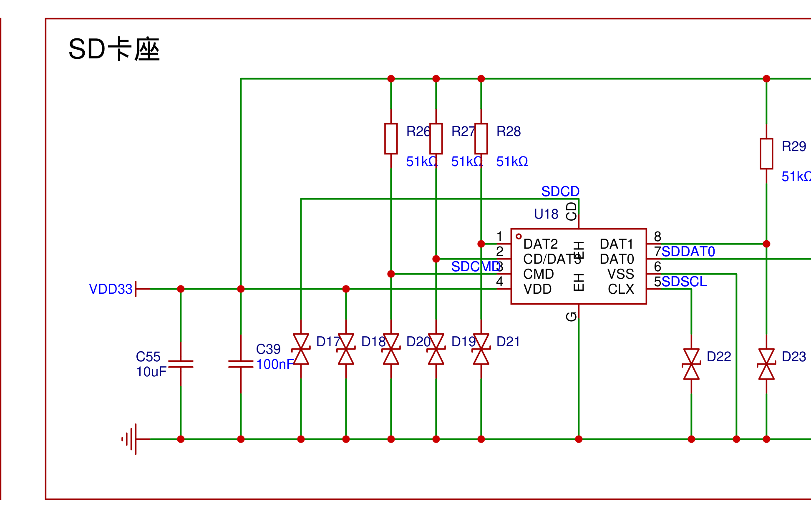

# Sabrina Carpenter, but pocket-sized ??

A tiny round screen. An ESP32. A looping Sabrina clip. An entirely reasonable use of a weekend.



**[Watch the actual little thing in action ?](demo/Recording.mp4)**

## What is this thing?

An Arduino video player for a VIEWE ESP32-S3 round display. It decodes MJPEG frames and keeps looping until the battery, USB cable, or your attention span gives up.

- Two editions: SD card and onboard flash.
- Default target: 1.75-inch CO5300 AMOLED, 466 ? 466.
- Source also includes 1.5-inch AMOLED and best-effort 1.85-inch TFT options.
- ESP32-S3-N16R8: 16 MB flash + OPI PSRAM.
- No app account. No cloud. Just vibes and JPEGs.

## Pick your adventure

| Edition | Where the video lives | Reality check |
|---|---|---|
| **[Flash player](editions/flash-player)** | Onboard flash | The working route: two hardware loops recorded at about 12.9 rendered FPS |
| **[SD player](editions/sd-player)** | FAT32 SD card | Original package. SD initialization on this board remains unresolved |

The flash player targets a 20 FPS timeline and skips frames when decoding falls behind. That preserves playback duration. It does not magically render 20 FPS.

## Put her on the screen

Install Python dependencies from the repository root:

```bash
python -m pip install -r requirements.txt
```

**Flash edition:** use a board already carrying the matching partition layout:

```bash
cd editions/flash-player
python flash.py COM10
```

Replace `COM10` with your board port. This writes the app at `0x10000` and video at `0x610000`. It expects the existing 16 MB, 3 MB app / 9.9 MB FATFS layout. The partition named `ffat` contains raw video here. **Do not format it.** This uploader does not install a partition table on a blank board.

**Original SD edition:** copy `media/video.mjpeg` to the FAT32 card root, then:

```bash
cd editions/sd-player
python flash.py
```

That uploader restores the original packaged firmware and partition files. The unresolved SD issue may still prevent playback. See [the investigation](docs/SD-DIAGNOSIS.txt).

Uploading replaces the firmware currently on the board. Close serial monitors first. If detection fails: hold BOOT, tap RST, release BOOT.

## Want to tinker?

Open the matching `.ino` in Arduino IDE.

- Board: **ESP32S3 Dev Module**
- Flash: **16 MB**, DIO
- PSRAM: **OPI PSRAM**
- USB CDC on boot: enabled
- Partition scheme: **16M Flash (3MB APP/9.9MB FATFS)**
- Recorded library setup: ESP32 core **3.3.12**, GFX Library for Arduino **1.6.8**, JPEGDEC **1.8.4**

`DISPLAY_TYPE` selects the screen. The ready-made binaries match the supplied build, so compile again if you change hardware settings.

`python tools/build_flash_player.py` regenerates the flash sketch and video image from the original SD source and `media/video.mjpeg`. It does **not** compile firmware. After compiling, update the flash manifest hashes before using its checksum-checked uploader.

## The extremely serious architecture

```text
MJPEG clip -> JPEGDEC -> Arduino_GFX -> round screen
                 ^                         |
                 |                         |
                 +------ again pls --------+
```

```text
editions/     Both sketches and matching flash packages
media/        Original clip + two MJPEG exports
demo/        Real-device recording
docs/        Wiring images + SD detective story
diagnostics/ SD investigation sketch and serial checker
tools/       Flash-source and video-image generator
```

The diagnostic helper defaults to the original COM10 setup. Adjust it for your machine. Historical diagnosis notes mention local backups and logs that stay outside this repository.

## Things this repo does not pretend

- The SD hardware fault is still a mystery. Flash playback bypasses it.
- Playback measurements came from the supplied device notes. No new hardware test was run for this upload.
- Duplicate compiler output, raw device backups, caches and chat exports stay local.
- This is an unofficial fan project. Sabrina Carpenter and her team are not affiliated. Included media belongs to its respective rights holders.

Built by **chilly23**, powered by questionable priorities and a very small screen.
